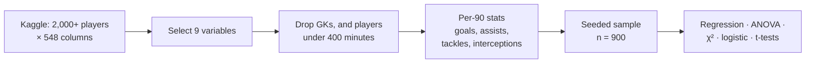

# What Drives a Footballer's Market Value?

**Statistical scouting on 900 players from Europe's top-5 leagues**

> **TL;DR:** Attacking output, age and league explain about half the variation in transfer value (adj. R² = 0.47). Defensive stats barely register. The market also applies an **"aging star discount" of about €14M** to older high performers, which gives value-focused clubs an opening.

 

## Six questions a club would ask

| # | Question | Method | Answer |
|:-:|:--|:--|:--|
| 1 | Which stats predict value? | Multiple linear regression on log(value) | Goals, assists, age and league (**adj. R² = 0.47**, p < 2e-16). Tackles and interceptions barely matter. |
| 2 | Are positions priced differently? | One-way ANOVA | **Yes** (F = 10.7, p = 2.6e-5). Forwards cost the most, around €16M on average. |
| 3 | Are €10M+ players spread evenly across leagues? | χ² test | **No** (χ² = 37.0, p = 1.8e-7). The Premier League concentrates them. |
| 4 | Who is "versatile" (strong in attack *and* defence)? | Logistic regression, odds ratios | Midfielders are **~3×** more likely than defenders. Minutes played don't matter. |
| 5 | Do some leagues trust young players more? | Two-proportion z-test | **Yes** (p = 0.032). |
| 6 | Does age discount high performers? | Two-sample t-test | **Yes**, by about **€14M**. |

## So what, for a club

- **Selling?** Sell attackers at their peak, because the discount arrives fast.
- **Buying on a budget?** Look for productive attackers just past the age cut-off.
- **Need squad depth?** Versatile midfielders give two positions' worth of cover.

## Data and method

- **Source:** [European Football Players Market Value](https://www.kaggle.com/datasets/mubarak2000/european-football-players-market-value) (Kaggle)
- `PlayerValueData.csv` is the raw data; `soccer_player_value_cleaned_project_data.csv` is the cleaned sample
- The minutes filter keeps per-90 stats honest: someone with 2 goals in 90 minutes is not a 2-goals-per-game striker

## Run it

Open `analysis.Rmd` in RStudio and click **Knit**.

## What I'd do next

- Try **gradient boosting with SHAP** to capture non-linear age curves the linear model misses
- Add **contract length**, which is probably the biggest missing driver of transfer fees
- Use **multi-season panel data** to separate peak age from regression to the mean

 

📄 <a href="report/report.pdf">Report</a> · <a href="report/presentation.pptx">Slides</a> · Boston University MET CS 555, Fall 2025
